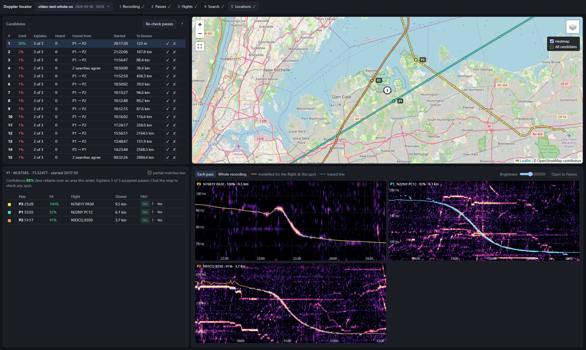
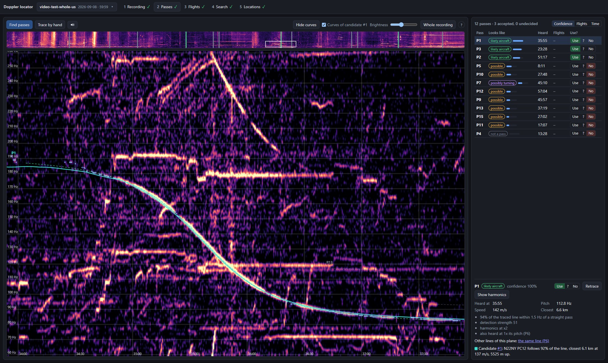
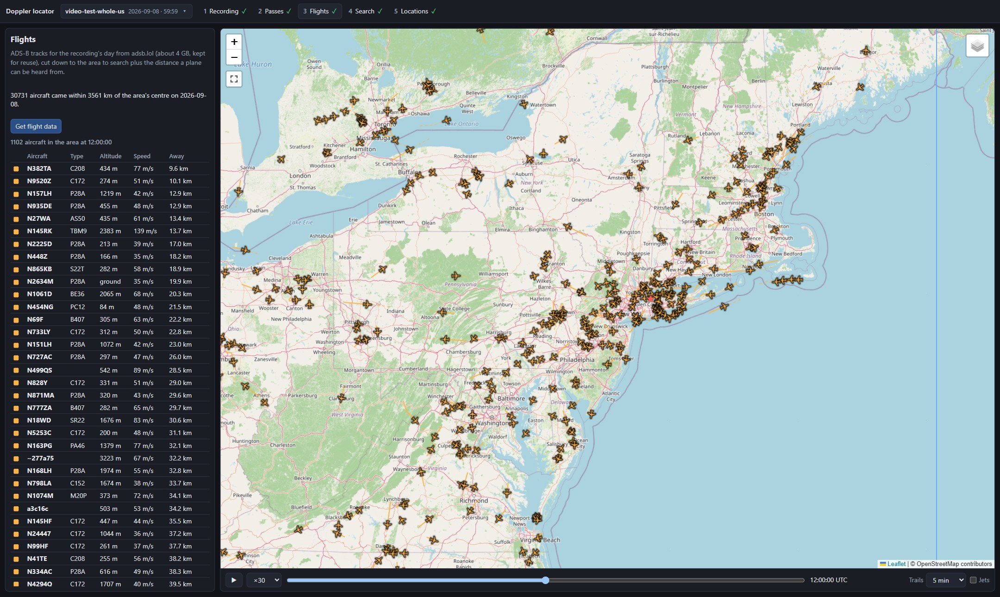

# doppler-localization

**Find where an audio recording was made, from the planes you can hear in it.**

A propeller plane flying past drops in pitch as it goes by. The shape of that drop depends on how
fast the plane was flying and how close it came. Public flight-tracking data (ADS-B, from
[adsb.lol](https://adsb.lol)) says where every equipped plane was, second by second. So the place
where the logged flights would have sounded just like the recording is where the microphone was.

This re-creates the method shown in [this video](https://www.youtube.com/watch?v=UytYrhYLOKI). On the
video's own one-hour test recording, it finds the spot to within about 120 m with no start time, whether it searches a
200 × 200 km area around New York, the whole lower 48 states or the whole Earth.



## Quick start

You need [uv](https://docs.astral.sh/uv/) and an internet connection: flight data, terrain heights and
map tiles are downloaded as needed.

```bash
git clone https://github.com/zingalorp/doppler-localization.git
cd doppler-localization
uv sync
uv run python -m doppler_loc.gui
```

Then open http://127.0.0.1:8765.

## Try it on the video's recording

The repo ships the video's test project, with its passes already reviewed, but not the audio. Fetch the
audio from [the video](https://www.youtube.com/watch?v=4CxVxuMVkMc) first:

```bash
uvx yt-dlp -f bestaudio -o "data/test_video/raw_audio.%(ext)s" https://www.youtube.com/watch?v=4CxVxuMVkMc
```

Then pick **video-test** in the app and go through the steps:

1. **Recording**: *Make spectrogram*.
2. **Passes**: already reviewed. Three passes are accepted.
3. **Flights**: *Get flight data*. This downloads adsb.lol's archive for the day once (about 4 GB).
4. **Search**: *Run search*. It uses half your CPU threads, so the computer stays usable.
5. **Locations**: the top candidate should be about 120 m from the red star, the known location.

## The five steps

| | |
|---|---|
| **1 Recording**: pick any audio or video file, and set the day it was recorded. Choose the area to search: a square, a shape drawn on the map, or a country or US state. A start time is optional, but it makes the search much stronger. | **2 Passes**: passes are found automatically and graded. Review them on a zoomable spectrogram, press the speaker to hear it from wherever you click, retrace any detected line that strays, and trace missed ones by clicking along the curve. |
| **3 Flights**: replay every aircraft over the area, in time with the recording. | **4 and 5 Search and Locations**: candidates are ranked by how many passes they explain, with each pass's flight and modelled curve shown. Check each curve by eye and mark whether it fits. |



## Good traces matter most

Everything the search knows about a pass comes from its traced line: the plane's speed, how close it
came and when. If a line wanders onto another sound or stops short, those numbers are wrong. The search
then looks in the wrong place, or finds nothing. A few well-traced passes beat many rough ones, so time
spent in step 2 pays off more than anything else.

### What to accept

- **Accept only what you're sure is a plane.** A wrong pass costs more than a missing one: the search
  pairs accepted passes with each other, so one wrong pass sends every pair it is in to the wrong place.
  Leave a doubtful line on *?*. It isn't searched with, and if a candidate's modelled curve follows it in
  step 5, you can accept it then.
- **Tell planes from other sounds.** A plane's tone slides smoothly from high to low over a minute or
  more, and propellers often show the same curve again at 2 or 3 times the pitch. Cars and trucks make
  the same shape in a few seconds. Train horns are chords that hold steady, birds are short chirps, and
  machinery hums at one pitch. Reject those.
- **Keep a few long, straight passes.** The search starts from passes whose curve is the clean,
  symmetric S of a plane flying straight past, and over a wide area it pairs the four most confident.
  Two or three of those, traced well, are worth more than everything else.
- **Accept turning planes too, but with at least one straight pass.** Planes near an airfield circle, climb
  and descend, so their curves bend, flatten or rise again. That's common. Their fitted speed and distance
  mean little, so the search pairs each one with a straight pass and only asks that a flight nearby follows
  the traced line. A short trace of a turning plane can still show high confidence, so check its curve by eye.

### How to trace

- **Trace the whole curve, flat ends included.** The longer the line, the better it pins down the plane's
  speed and distance. A line of under two minutes fits many flights by chance.
- **Click along the middle of the brightest line, and stay on one curve.** Where two curves cross or run
  close, keep to the one you started on. Two planes can sound close in pitch, so check the other one is
  traced separately. Press the speaker to listen to the stretch you're tracing.
- **Retrace any detected line that strays.** Select the pass, press *Retrace*, click along the curve
  from start to end, then press *Measure from points*. The new trace stays within about 1.5 Hz of your
  clicks, even where a louder sound crosses it. Detected lines often run on past the bright part at the
  ends, so check those first.
- **Trace the clearest harmonic.** The others are grouped with it automatically. *Show harmonics* in a
  pass's details draws its line at multiples of its pitch, so you can see whether anything bright runs
  along it. A line with at least two harmonics found is sharpened with them when measured.



## Check the answer by eye

A search gives you candidates to check, not just an answer to trust. Pick one in step 5 to see which
flight it matched to each pass, with that flight's modelled curve over your spectrogram.

- **Compare each curve with the traced line.** At the right spot, the curve follows the line from start
  to end, including the steep middle.
- **Read its confidence.** It says how likely the spot is right, to within about a kilometre, from its
  lead over the best spot elsewhere and the share of accepted passes it explains. It's a guide, tuned on
  19 test searches of 13 recordings.
- **Mark whether it fits.** Each pass has *Fits?* buttons: Yes counts it in full, ? half, and No not at
  all. Faded buttons show the automatic grade. Your answer holds for that candidate only, and updates the
  ranking and confidence at once. With a known start, you can check the flights heard on the spectrogram
  the same way.
- **Check a spot of your own.** Click the map to check any spot in the area as a candidate, with its own
  confidence and curves, then keep it or discard it.
- **Look closer.** *Partial matches too* adds flights that follow only part of a line, and *Whole
  recording* shows the curves across the full spectrogram.
- **Fix the pass if the trace is the problem.** *Open in Passes* takes you back to step 2 to retrace or
  reject it. Then press *Re-check passes*.
- **Record your conclusion.** ✓ and ✗ mark a candidate right or wrong. They don't change the ranking.

## How it works

- **Measure each pass.** The plane's tone is traced across the spectrogram, and a flyby is fitted to
  the trace. The fit gives the tone's true pitch, the speed, the closest distance, and when the plane
  was closest.
- **Search with pairs of passes.** Two passes heard some minutes apart must come from two logged flights
  heard from the same spot, at the same recording start time, so those two flights must have been close
  to each other at those times. With no start time, the search compares the flights first, then checks a
  grid only where a pair could be heard. Filters on speed, distance, timing and silence cut those points
  down, and the modelled curve at each one left is scored against the spectrogram.
- **Pair turning passes with straight ones.** The straight pass fixes its flight and the recording's start.
  The turning pass's flight then only has to be within earshot, with a curve that follows the traced line.
- **Polish and rank the pairs.** The most promising flight pairs are moved to where their curves fit best,
  then checked against every pass. The best are refined to 25 m: the top 30 per pair of passes, or the top
  10 with a known start.
- **With a known start time:**
  - every pass is also searched on its own, and votes for places;
  - the spectrogram is stacked along every flight's predicted curve, so even passes nobody traced add
    evidence. This produces the heatmap on the map.
- **Rank the candidates.** Each candidate is checked against all the passes. A flight that follows a
  traced line counts in full, and one only heard on the spectrogram counts half, so tracing it adds
  evidence. A flight never counts as both. Candidates that the same flights support are merged into one.

The physics allows for the time sound takes to travel, uses the ground height under each point, and
corrects for the geoid. A spot and its mirror image across a flight path sound alike, so a second pass
is needed to tell them apart.

## Grid spacing

Step 4's *Grid spacing* sets how far apart the search's points are. It defaults to 500 m. A coarser grid is quicker.

- **Without a start time,** each promising flight pair is moved to where it fits best, so spacing usually matters
  little. But a grid that is too coarse can lose the right answer altogether, so use 500 m if a 1 km search fails.
- **With a start time,** a coarser grid is quicker but can land up to a few hundred metres further away.

## Searching a country, or the Earth

In step 1, pick a country or US state, draw a shape, or set *This far each way*: 2500 km from about 38.5, -96 covers
the lower 48, and 16000 km covers the Earth. From 500 km each way:

- Step 3 keeps only low flying by aircraft that aren't jets: a day over the US is about 1.7 GB.
- The search uses only pairs of passes, from the 4 most reliable ones, though every accepted pass is still
  checked. It needs at least 2 accepted passes, and a start time is optional.
- It takes much longer than a small area, and can use up to about 19 GB of memory. Turning passes add the most time
  (see *Thorough or fast*).

Searching the whole Earth at 1 km, with no start time, the video test's top candidate was 123 m from the known spot,
at 98% confidence.

The more well-traced passes you accept, the better the chances, and the confidence number is less reliable at this
scale: an earlier wrong answer from just 2 passes still scored 94%.

## Thorough or fast

Step 4's *Search* setting decides what happens with turning passes. **Thorough**, the default, pairs each one with a
straight pass. **Fast** leaves those pairs out. If every accepted pass is straight, the two are the same.

If some passes turn, Fast is much quicker across a country, but it's less likely to find the place: in our tests it
missed places that Thorough found. With a known start over a small area, Thorough adds very little time, so Fast isn't
worth using there.

## Limits

- **It only works with planes that broadcast ADS-B.** Planes without it (most light aircraft in Europe,
  and some in the US) leave passes that no flight can explain.
- **The flight data must cover low flying.** Far from any receiver, adsb.lol logs airliners overhead but
  not the small planes heard close by. The app warns when that is the case for your area.
- **It needs logged planes heard close by.** Two or more passes usually pin the place down. With one, it is
  rarely sure, and with none, any answer it gives is a guess that it shows as unsure.
- **Turning planes are only partly handled.** Automatic detection assumes straight, steady passes, so
  turning planes are best traced by hand, and the search needs at least one straight pass to pair them with.
- **The physics is simplified.** The speed of sound is fixed at 343 m/s, and wind is ignored.

## Other tools

```bash
uv run pytest -q                       # tests
uv run python scripts/demo.py          # synthetic scenarios with known answers; figures in out/
uv run python scripts/test_video.py search      # the video test without the GUI
uv run python scripts/eclipse.py fetch 22224306 # an Eclipse Soundscapes recorder (CC BY), by its Zenodo number
uv run python scripts/search_bench.py freeze    # projects with a known spot become fixed search tests
uv run python scripts/search_bench.py run --quick   # search them all again; compare with `report`
```

Each script's docstring has the details.

Every step can also run without the GUI:
`uv run python -m doppler_loc.project <prepare|detect|fetch|search|explain> data/projects/<name>`.

## Use it responsibly

This tool can show where a recording was made. Use it on your own recordings, or with the permission of
whoever made them, and never to find or follow people.

## Data sources

- **Flight data:** [adsb.lol](https://adsb.lol)'s daily archives
  ([globe_history](https://github.com/adsblol)), under the ODbL.
- **Aircraft types:** [tar1090-db](https://github.com/wiedehopf/tar1090-db).
- **Terrain heights:** [AWS Terrain Tiles](https://registry.opendata.aws/terrain-tiles/).
- **Geoid:** EGM96 through [PROJ](https://proj.org).
- **Maps:** © [OpenStreetMap](https://www.openstreetmap.org/copyright) contributors; satellite imagery © Esri.
- **Country and state outlines:** [Natural Earth](https://www.naturalearthdata.com) and the US Census Bureau, through
  [world-atlas](https://github.com/topojson/world-atlas) and [us-atlas](https://github.com/topojson/us-atlas).

## License

Copyright (c) 2026 zingalorp. The code is under the [GNU General Public License, version 3 or later](LICENSE): anyone
can use, change and share it, as long as anything they distribute from it stays open source under the same license.
The data it downloads comes under its sources' own terms (see Data sources).

Claude, Anthropic's AI assistant, was used in developing this project.
